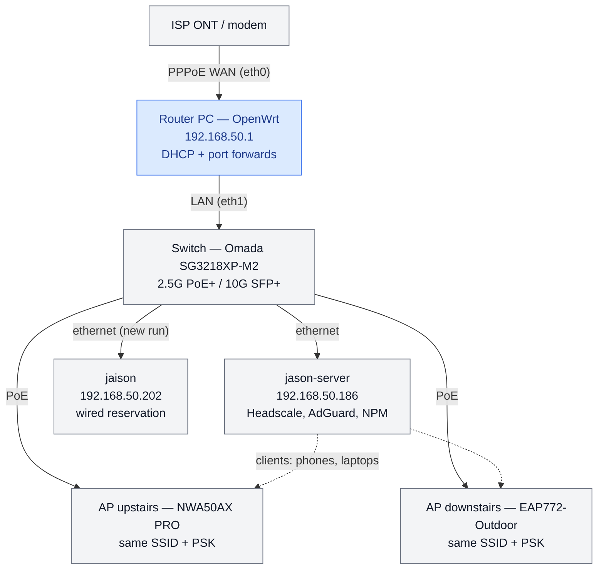

# OpenWrt migration

Replace the ASUS RT-AX58U with the router PC running OpenWrt. Same subnet
(`192.168.50.0/24`, gateway `.1`), same SSID + password on the two APs, so
servers and clients never change a setting. Target downtime: the length of
the WAN flip — about a minute.

## Final state



Everything left of the switch is new; everything right of it already exists
and is only re-cabled. Wi-Fi lives entirely on the APs (dumb/bridge mode,
DHCP off) — the router PC has no radio, and clients keep their IPs because
the subnet and DHCP reservations are cloned.

## Cutover steps

Steps 0–3 take down nothing. Only step 5 does.

**Step 0 — Gather config (old router live).**
SSH is enabled on the ASUS at port **56765**, user `jf_fagerberg`. Its shell
only takes interactive input, so the dump is hand-driven:

```bash
./scripts/asus-dump.sh    # password, then at the router prompt: `nvram show`, wait, `exit`
```

Fill `.env` from the report: PPPoE user/pass, `staticmap_*` reservations,
`virtualserver_*` port forwards, DHCP pool, timezone.

**Step 1 — Build the router config offline.**
Copy this whole directory + `.env` to a FAT32 USB stick. On the OpenWrt PC
(console or laptop wired to its LAN port):

```bash
sh /mnt/sda1/scripts/openwrt-clone.sh       # PPPoE creds, LAN .1/24, DHCP, reservations, forwards
```

**Step 2 — Prep the APs (upstairs one stays unpowered until cutover).**
Both are Omada APs — they bridge, they never hand out DHCP, so there is
nothing to turn off. In each AP's management UI (or Omada app via Bluetooth):
set the exact same SSID + password + WPA2/WPA3 mode as the ASUS (values from
the step-0 dump). The downstairs EAP772-Outdoor is already mounted and
PoE-fed; the upstairs NWA50AX PRO needs mounting + a PoE run first.
Do not bring the upstairs AP live before cutover — two broadcast SSIDs make
clients roam onto a network with no working router.

**Step 3 — Pre-verify the router (still offline).**
Laptop in a LAN port: it should get a `192.168.50.1xx` lease and
`ssh root@192.168.50.1` should work. PPPoE won't dial yet — no WAN cable —
that's expected.

**Step 4 — Move the LAN.**
ISP cable stays in the old router. Switch, jason-server, jaison, and both APs
up on the router PC's LAN port — everything hardwired through the switch,
APs powered on. LAN is served by OpenWrt; no internet until step 5.

**Step 5 — Flip the WAN (~1 minute down).**
Unplug the ISP line from the ASUS, plug it into the router PC's `eth0`.
`logread -f` shows `pppoe-wan: renamed`, then a public IP.

**Step 6 — Verify, then take it from headscale.**

```bash
ifstatus wan | grep -A2 ipv4_address        # PPPoE up with a public IP
ssh jason-server@192.168.50.186             # LAN + reservations work
dig @192.168.50.186 plex.jasonfagerberg.duckdns.org   # AdGuard path
```

Then from anywhere: `tailscale status`, `ssh jason-server@jason-server.hs.internal`.
Rollback = plug the ISP line back into the ASUS; nothing on the servers changed.

## Notes

- `openwrt-clone.sh` is idempotent — re-run it after editing `.env` any time before cutover.
- The dump files under `dumps/` contain the Wi-Fi PSK and router secrets: gitignored, `0600`.
- IPv6 is off on day one (the old router had a WAN v6 address but no LAN v6
  was in use); re-add after the move is stable.
- Public 80/443/25565 move from UPnP-opened to explicit DNAT rules; no other
  forwarded ports exist (see inventory §4).
